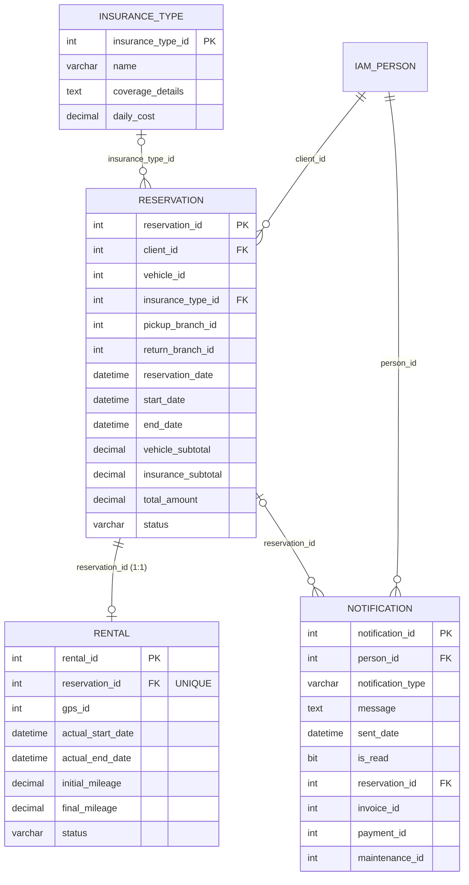

# rtm-booking-db

Migraciones de base de datos (Liquibase) del servicio **Booking & Reservation** de RentaMovil:
reservas, ejecución de la renta (pickup / devolución) y notificaciones in-app.

Este repo **solo** define el esquema. El código del servicio está en
[`rtm-booking-reservation`](https://github.com/RentaMovil/rtm-booking-reservation), que se conecta
a las tablas creadas aquí y nunca las modifica.

| | |
|---|---|
| Motor | SQL Server |
| Base de datos | `rentamovil` (compartida por todos los servicios de RentaMovil) |
| Schema propio | `booking` — ninguna tabla de este repo va en `dbo` |
| Tablas | `insurance_type`, `reservation`, `rental`, `notification` |
| Herramienta | Liquibase 5.0.4 (plugin de Maven o imagen Docker) |
| Historial Liquibase | `dbo.DATABASECHANGELOG_BOOKING` / `dbo.DATABASECHANGELOGLOCK_BOOKING` |
| Usuario de la aplicación | `booking_app` (creado en `03_dcl`) |

## Contenido

- [Modelo de datos](#modelo-de-datos)
- [Estado actual](#estado-actual)
- [Estructura del repositorio](#estructura-del-repositorio)
- [Requisitos](#requisitos)
- [Configuración](#configuración)
- [Uso local con Maven](#uso-local-con-maven)
- [Uso con Docker](#uso-con-docker)
- [Usuario de base de datos `booking_app`](#usuario-de-base-de-datos-booking_app)
- [Cómo agregar un cambio de esquema](#cómo-agregar-un-cambio-de-esquema)
- [Ramas y contribución](#ramas-y-contribución)

## Modelo de datos



`IAM_PERSON` es `iam.person`, creada por `rtm-iam-db`.

### Reglas que impone la base

| Tabla | Restricción | Regla |
|---|---|---|
| `insurance_type` | `ck_insurance_type_daily_cost` | `daily_cost >= 0` |
| `reservation` | `ck_reservation_status` | `PENDING_PAYMENT`, `PENDING_REVIEW`, `CONFIRMED`, `CANCELLED`, `COMPLETED` |
| `reservation` | `ck_reservation_total` | `total_amount = vehicle_subtotal + insurance_subtotal` (INV-008) |
| `reservation` | `ck_reservation_amounts` | subtotales `>= 0` |
| `rental` | `uq_rental_reservation_id` | una reserva se ejecuta una sola vez (1:1) |
| `rental` | `ck_rental_status` | `IN_PROGRESS`, `COMPLETED` |
| `rental` | `ck_rental_completion` | una renta `COMPLETED` tiene `actual_end_date` y `final_mileage` |
| `rental` | `ck_rental_mileage` | `initial_mileage >= 0` |
| `notification` | `ck_notification_type` | `RESERVATION_CREATED`, `RESERVATION_CANCELLED`, `RESERVATION_RETURN_BRANCH_CHANGED`, `RESERVATION_RETURN_DATE_EXTENDED`, `RESERVATION_EXPIRED`, `PAYMENT_APPROVED`, `PAYMENT_REJECTED`, `MAINTENANCE_COMPLETED` |

Las reglas que dependen de "ahora" (`end_date > start_date`, el plazo de 3 días de INV-013) **no**
son `CHECK`: se validan en la aplicación, porque SQL Server no puede evaluarlas de forma fiable en
una restricción.

### Índices

| Índice | Para qué |
|---|---|
| `ix_reservation_client_id` | "Mis reservas" (HU-BOOKING-004) |
| `ix_reservation_status_reservation_date` | Panel de administración y cola de revisión de pagos |
| `ix_notification_person_is_read` | Campana de notificaciones no leídas por usuario |

## Estado actual

El esquema está completo para este servicio, pero algunas columnas apuntan a tablas de servicios
que **todavía no existen**, así que sus FKs aún no están creadas:

| Columna | FK pendiente hacia | Servicio dueño |
|---|---|---|
| `reservation.vehicle_id` | `fleet.vehicle` | `fleet-maintenance` |
| `reservation.pickup_branch_id`, `return_branch_id` | `fleet.branch` | `fleet-maintenance` |
| `rental.gps_id` | `telemetry.gps` | `telemetry-gps` |
| `notification.invoice_id` | `payment.invoice` | `payment-billing` |
| `notification.payment_id` | `payment.payment` | `payment-billing` |
| `notification.maintenance_id` | `fleet.vehicle_maintenance` | `fleet-maintenance` |

Esas columnas ya tienen el nombre y el tipo definitivos, y las obligatorias son `NOT NULL`. Cada FK
se añadirá en un changeset **nuevo** de este repo cuando el servicio dueño esté migrado (un
changeset ya aplicado nunca se edita).

FKs que sí existen: `reservation → iam.person`, `reservation → insurance_type`,
`rental → reservation`, `notification → iam.person` y `notification → reservation`.

## Estructura del repositorio

```
changelog/changelog-master.yaml   Punto de entrada: incluye 01_ddl → 02_dml → 03_dcl → 04_tcl
01_ddl/                           DDL
  01_schemas/                       CREATE SCHEMA booking
  03_tables/                        CREATE TABLE (sin FKs)
  04_alter/                         FKs y demás ALTER
  05_views/                         CREATE VIEW (vacío)
  10_indexes/                       CREATE INDEX
02_dml/                           DML (vacío a propósito, ver abajo)
  00_inserts/                       datos de referencia
  01_updates/                       backfills y correcciones
  02_deletes/                       eliminación de datos
03_dcl/                           DCL
  00_roles/                         login y usuario booking_app
  01_grants/                        permisos de booking_app
04_tcl/                           TCL
  02_release_tags/                  tags de versión (tagDatabase)
05_rollbacks/                     Espejo de 01_ddl … 04_tcl: un .rollback.sql por cada .sql
```

- Cada carpeta hoja tiene sus archivos `NNN_descripcion.sql` (dialecto SQL Server) y un
  `changelog.yaml` con un `changeSet` por archivo, cuyo `rollback` apunta a `05_rollbacks/`.
- Las carpetas vacías existen igual: su `changelog.yaml` tiene `databaseChangeLog: []` y su espejo
  en `05_rollbacks/` tiene un `.gitkeep`. Los huecos en la numeración son intencionales.
- `02_dml/` está vacío porque los planes de seguro los crea un Administrador desde la aplicación
  (HU-BOOKING-009), no un seed.

## Requisitos

- Java 17+ y Maven 3.9+ (para correr con Maven)
- Docker Desktop (para correr con Docker)
- **SQL Server ya levantado y migrado por `rtm-iam-db`.** Este repo no levanta SQL Server: necesita
  la base `rentamovil`, la tabla `iam.person` y `shared.audit`, que crea IAM.

Orden para levantar todo el sistema:

```
rtm-iam-db → rtm-booking-db → rtm-iam → rtm-booking-reservation → rtm-api-gateway
```

## Configuración

```bash
cp .env.example .env                                   # lo usa docker-compose.yml
cp liquibase.properties.example liquibase.properties   # lo usa el plugin de Maven
```

Ninguno de los dos se sube al repo (están en `.gitignore`).

| Variable | Archivo | Descripción |
|---|---|---|
| `MSSQL_SA_PASSWORD` / `password` | `.env` / `liquibase.properties` | Contraseña de `sa`. Debe coincidir con la de `rtm-iam-db`. |
| `MSSQL_PORT` | `.env` | Puerto de SQL Server (por defecto `1433`). |
| `MSSQL_DATABASE` | `.env` | Base de datos (por defecto `rentamovil`). |
| `BOOKING_APP_PASSWORD` / `parameter.bookingAppPassword` | `.env` / `liquibase.properties` | Contraseña del usuario `booking_app`. Debe ser la misma que `DATABASE_PASSWORD` en `rtm-booking-reservation/.env`. |

## Uso local con Maven

```bash
mvn liquibase:status       # qué changesets faltan por aplicar
mvn liquibase:updateSQL    # muestra el SQL sin ejecutarlo
mvn liquibase:update       # aplica las migraciones

mvn liquibase:rollback -Dliquibase.rollbackCount=1   # deshace el último changeset
```

> Al usar parámetros, el plugin imprime un `NoSuchFieldException: The field
> 'parameter.bookingAppPassword' could not be found...` con stack trace. Es inofensivo: lo que
> importa es el `BUILD SUCCESS` final.

## Uso con Docker

Todos los repos de RentaMovil comparten la red Docker `rentamovil`.

```bash
# Una sola vez por máquina
docker network create rentamovil

# Primero SQL Server + migraciones de IAM
cd ../rtm-iam-db && docker compose up -d

# Después las migraciones de booking
cd ../rtm-booking-db && docker compose up -d
```

| Contenedor | Qué hace | Estado esperado |
|---|---|---|
| `migrations` | Corre `liquibase update` contra el contenedor `sqlserver` y se apaga | `Exited (0)` |

La imagen (`Dockerfile`) parte de `liquibase/liquibase:5.0.4`, añade el mismo driver
`mssql-jdbc` que usa el `pom.xml` (para que Maven y Docker calculen los mismos checksums) y copia
los changelogs dentro de la imagen. Si las migraciones ya están aplicadas, no hace nada.

## Usuario de base de datos `booking_app`

Las migraciones corren con `sa`; el servicio **nunca**. `rtm-booking-reservation` se conecta con
`booking_app`, que tiene:

- `SELECT, INSERT, UPDATE, DELETE` sobre el schema `booking`.
- `INSERT` sobre `shared.audit` (la auditoría es de solo escritura para la aplicación).
- Nada más: sin DDL, sin acceso a `dbo` ni a los schemas de otros servicios (`iam`, `fleet`,
  `telemetry`, ...).

Así se respeta la propiedad de datos entre servicios aunque la base sea físicamente compartida.
Las FKs que cruzan schemas siguen funcionando porque las valida el motor, no el usuario.

La contraseña no está en el repo: llega como parámetro (`bookingAppPassword`). Si falta, el
changeset falla a propósito con `Missing parameter.bookingAppPassword in liquibase.properties`.

## Cómo agregar un cambio de esquema

1. Crea el `.sql` en la carpeta que corresponda con el siguiente número
   (p. ej. `01_ddl/04_alter/002_add_fks_fleet.sql`).
2. Crea su rollback en el espejo de `05_rollbacks/` (`002_add_fks_fleet.rollback.sql`).
3. Añade el `changeSet` al `changelog.yaml` de esa carpeta, con `rollback` apuntando al archivo
   del paso 2.
4. Verifica con `mvn liquibase:updateSQL` y aplica con `mvn liquibase:update`.
5. Prueba el rollback con `mvn liquibase:rollback -Dliquibase.rollbackCount=1` y vuelve a aplicar.

**Nunca** modifiques un changeset que ya se aplicó en algún entorno: Liquibase detecta el cambio
de checksum y falla. Los cambios siempre van en un changeset nuevo.

## Ramas y contribución

- `main`: versión estable.
- `develop`: integración.
- Ramas de trabajo `feat/…`, `fix/…`, `chore/…` → Pull Request a `develop` (Squash and Merge).
- `develop` se integra en `main` para cada versión.
